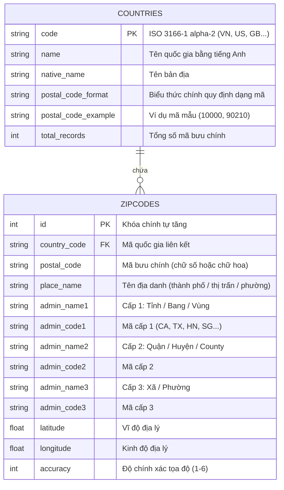

# Thiết Kế Dữ Liệu (Data Model Specification)

## 1. Mô Hình Thực Thể (Entity Relationship)

Hệ thống sử dụng cơ sở dữ liệu SQLite cục bộ được chuẩn hóa cao, tối ưu cho việc đọc (Read-heavy) và tìm kiếm tốc độ cao.



---

## 2. Chi Tiết Các Trường Dữ Liệu (Field Specifications)

### Bảng `countries`
Lưu trữ danh sách các quốc gia được hệ thống hỗ trợ.

| Tên Cột | Kiểu Dữ Liệu | Ràng Buộc | Mô Tả |
|---|---|---|---|
| `code` | `TEXT` | `PRIMARY KEY`, 2 ký tự | Mã quốc gia theo chuẩn ISO 3166-1 alpha-2 (chữ in hoa: `VN`, `US`, `GB`). |
| `name` | `TEXT` | `NOT NULL` | Tên quốc gia hiển thị chuẩn quốc tế (ví dụ: `Vietnam`, `United States`). |
| `native_name` | `TEXT` | `NULLABLE` | Tên quốc gia theo ngôn ngữ địa phương (ví dụ: `Việt Nam`). |
| `postal_code_format` | `TEXT` | `NULLABLE` | Regex quy định khuôn dạng mã bưu chính của quốc gia đó. |
| `postal_code_example` | `TEXT` | `NOT NULL` | Ví dụ mã bưu chính đại diện để làm placeholder trong UI. |
| `total_records` | `INTEGER` | `DEFAULT 0` | Số lượng bản ghi mã bưu chính của quốc gia trong hệ thống. |

### Bảng `zipcodes`
Bảng dữ liệu trung tâm phục vụ tra cứu. Dữ liệu chuẩn hóa dựa trên cấu trúc GeoNames Postal Codes.

| Tên Cột | Kiểu Dữ Liệu | Ràng Buộc | Mô Tả |
|---|---|---|---|
| `id` | `INTEGER` | `PRIMARY KEY AUTOINCREMENT` | Định danh duy nhất cho từng bản ghi. |
| `country_code` | `TEXT` | `NOT NULL`, FK | Mã quốc gia liên kết đến `countries.code`. |
| `postal_code` | `TEXT` | `NOT NULL` | Chuỗi mã bưu chính (ví dụ: `90210`, `10000`, `SW1A 1AA`). |
| `place_name` | `TEXT` | `NOT NULL` | Tên địa danh (thị trấn, quận, xã hoặc địa điểm bưu chính). |
| `admin_name1` | `TEXT` | `NULLABLE` | Tên đơn vị hành chính cấp 1 (Tỉnh/Thành, Bang). |
| `admin_code1` | `TEXT` | `NULLABLE` | Mã viết tắt cấp 1 (ví dụ: `CA` cho California, `HN` cho Hà Nội). |
| `admin_name2` | `TEXT` | `NULLABLE` | Tên đơn vị hành chính cấp 2 (Quận/Huyện/County). |
| `admin_code2` | `TEXT` | `NULLABLE` | Mã viết tắt cấp 2. |
| `admin_name3` | `TEXT` | `NULLABLE` | Tên đơn vị hành chính cấp 3 (Xã/Phường). |
| `latitude` | `REAL` | `NULLABLE` | Tọa độ vĩ độ (Latitude WGS84). |
| `longitude` | `REAL` | `NULLABLE` | Tọa độ kinh độ (Longitude WGS84). |
| `accuracy` | `INTEGER` | `NULLABLE` | Độ chính xác tọa độ (1: ước lượng cấp quốc gia -> 6: chính xác vị trí bưu điện). |

---

## 3. Chiến Lược Đánh Chỉ Mục (Index Design)

Để đảm bảo tốc độ phản hồi tìm kiếm luôn dưới 10ms trên tập dữ liệu lớn:

```sql
-- 1. Index tìm kiếm nhanh theo mã bưu chính trong từng quốc gia
CREATE INDEX IF NOT EXISTS idx_zipcodes_country_postal 
ON zipcodes (country_code, postal_code);

-- 2. Index tìm kiếm theo tên địa danh trong từng quốc gia
CREATE INDEX IF NOT EXISTS idx_zipcodes_country_place 
ON zipcodes (country_code, place_name);

-- 3. Index tìm kiếm toàn cầu theo mã bưu chính (khi không chọn quốc gia)
CREATE INDEX IF NOT EXISTS idx_zipcodes_postal_global 
ON zipcodes (postal_code);

-- 4. Index tìm kiếm toàn cầu theo tên địa danh
CREATE INDEX IF NOT EXISTS idx_zipcodes_place_global 
ON zipcodes (place_name);
```

---

## 4. Quy Chuẩn Dữ Liệu Nguồn & Nạp Vào Cloudflare D1 (Data Ingestion & Seed Data)

1. **Nguồn Dữ Liệu & Quy Mô (Toàn Cầu - Phương Án 2):**
   - **Quốc tế:** Tập dữ liệu đầy đủ toàn cầu từ GeoNames (`allCountries.zip`) chứa hơn **1.200.000 bản ghi** của gần 100 quốc gia trên thế giới.
   - **Việt Nam:** Bổ sung tập dữ liệu chuẩn hóa mã bưu chính quốc gia 5 chữ số từ VNPost / Bộ TT&TT (khoảng **30.000 bản ghi** phủ khắp 63 tỉnh thành).
   - **Dung lượng ước tính:** Tổng dung lượng file SQLite (gồm cả bảng và các index B-Tree) đạt khoảng **140 MB – 180 MB**, nằm an toàn trong hạn mức 500 MB của Cloudflare D1 Free Tier.

2. **Cơ Chế Khởi Tạo Bảng & Chỉ Mục (Schema Migrations):**
   - File định nghĩa bảng: `migrations/0001_initial_schema.sql` chứa toàn bộ câu lệnh `CREATE TABLE` và `CREATE INDEX` chuẩn SQLite.
   - Chạy migration trên môi trường cục bộ:
     ```bash
     npx wrangler d1 execute zipcodes-db --local --file=./migrations/0001_initial_schema.sql
     ```
   - Chạy migration trên Cloudflare D1 production:
     ```bash
     npx wrangler d1 execute zipcodes-db --remote --file=./migrations/0001_initial_schema.sql
     ```

3. **Chiến Lược Chia Nhỏ & Nạp Dữ Liệu Lớn (Chunking & Ingestion Strategy):**
   - Do tập dữ liệu lớn (~1.2 triệu dòng), Wrangler CLI khuyến nghị mỗi lần thực thi file SQL không vượt quá dung lượng giới hạn.
   - Script tiền xử lý `scripts/generate-d1-sql.ts` sẽ đọc file nguồn `allCountries.txt` và dữ liệu VN, chuẩn hóa chuỗi và chia nhỏ thành các file SQL phân đoạn (chunks): `data/seed/chunks/chunk_001.sql`, `chunk_002.sql`,... (mỗi file chứa 5.000 – 10.000 bản ghi batch inserts).
   - Script nạp tự động `scripts/import-all.ts` (hoặc bash/powershell runner) thực thi lần lượt qua Wrangler:
     ```bash
     # Nạp cho môi trường local dev
     npm run db:seed:local
     # Nạp cho môi trường production trên Cloudflare D1
     npm run db:seed:remote
     ```
