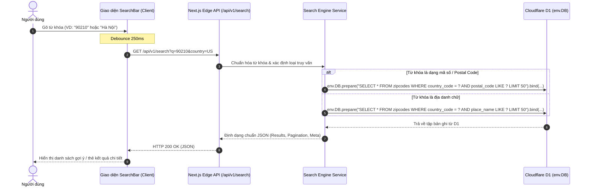

# Tổng Quan Kiến Trúc Hệ Thống (System Overview)

## 1. Mục Đích & Bối Cảnh
Tài liệu này mô tả kiến trúc tổng thể của hệ thống ZipCode Tools, bao gồm các thành phần công nghệ, luồng xử lý dữ liệu và mô hình triển khai ứng dụng.

---

## 2. Công Nghệ Lựa Chọn (Technology Stack)

| Thành Phần | Công Nghệ Lựa Chọn | Lý Do Lựa Chọn |
|---|---|---|
| **Framework Chính** | Next.js (App Router, Edge Runtime, TypeScript) | Tích hợp cả Frontend và Backend, hỗ trợ render phía máy chủ (SSR/SSG), tương thích hoàn toàn với Cloudflare Pages thông qua `@cloudflare/next-on-pages` hoặc OpenNext. |
| **Giao Diện (Styling & UI)** | Tailwind CSS + Lucide Icons | Xây dựng giao diện hiện đại, responsive nhanh chóng, tùy biến dễ dàng, bundle size gọn nhẹ. |
| **Hạ Tầng Triển Khai (Hosting)** | **Cloudflare Pages** (V8 Edge Runtime) | Triển khai trên mạng lưới Edge toàn cầu (300+ PoPs), độ trễ cực thấp, băng thông miễn phí không giới hạn, tích hợp sẵn SSL và chống DDoS. |
| **Cơ Sở Dữ Liệu (Database)** | **Cloudflare D1** (Serverless SQLite) | Database quan hệ serverless chuẩn SQLite phân tán của Cloudflare, độ trễ truy vấn siêu thấp ngay tại Edge, chi phí vận hành tối ưu. |
| **Truy Vấn Dữ Liệu** | Cloudflare D1 Binding API / Drizzle ORM | Kết nối trực tiếp qua `env.DB` native binding trong request context của Worker, đảm bảo tốc độ tối đa không có overhead kết nối TCP ngoài. |

---

## 3. Kiến Trúc Phân Lớp (Layered Architecture)

```mermaid
graph TD
    User["Người Dùng Trình Duyệt (Web Browser / Mobile)"]

    subgraph CloudflareEdge ["Hạ Tầng Biên Cloudflare (Cloudflare Edge Network)"]
        subgraph ClientLayer ["Client Layer (React UI)"]
            SearchBar["Thanh Tìm Kiếm Đa Năng (Smart SearchBar)"]
            CountrySelector["Bộ Lọc Quốc Gia (Country Select)"]
            ResultsView["Danh Sách Kết Quả & Thẻ Chi Tiết (Result Cards)"]
            CopyHelper["Tiện Ích 1-Click Copy"]
        end

        subgraph EdgeCompute ["Next.js Edge Runtime (Cloudflare Pages)"]
            PageRoutes["Trang Tĩnh & Động (SSR / SSG for SEO)"]
            APIRoutes["Route Handlers (/api/v1/search, /api/v1/countries)"]
            SearchService["Search & Normalization Service (Fuzzy match, Prepared Statements)"]
        end

        subgraph D1Layer ["Cloudflare D1 Database (Serverless SQLite)"]
            D1DB[("Cloudflare D1 (env.DB)")]
            IndexPostal["Index: (country_code, postal_code)"]
            IndexPlace["Index: (country_code, place_name)"]
        end
    end

    User -->|HTTPS Request| ClientLayer
    ClientLayer -->|Fetch API / Dynamic Navigation| EdgeCompute
    APIRoutes --> SearchService
    PageRoutes --> SearchService
    SearchService -->|env.DB.prepare().bind().all()| D1DB
    D1DB -.-> IndexPostal
    D1DB -.-> IndexPlace
```

---

## 4. Luồng Xử Lý Tra Cứu (Search Execution Flow)



---

## 5. Chiến Lược Tối Ưu Hiệu Năng & SEO (Performance & SEO Strategy)

1. **Chỉ Mục Cơ Sở Dữ Liệu Tối Ưu:**
   - Tạo index phối hợp: `CREATE INDEX idx_country_postal ON zipcodes (country_code, postal_code);`
   - Tạo index tìm kiếm địa phương: `CREATE INDEX idx_country_place ON zipcodes (country_code, place_name);`
   - Nhờ đó, dù bảng dữ liệu có 500.000 đến 1.500.000 dòng, thời gian tìm kiếm vẫn luôn dưới 5ms.
2. **Debounce Phía Client:**
   - Cơ chế Debounce 200 - 300ms trong ô nhập liệu giúp hạn chế số lượng request không cần thiết khi người dùng đang gõ phím.
3. **Server-Side Generation & Metadata Động Cho SEO:**
   - Các trang danh mục quốc gia (`/countries/[code]`) và chi tiết mã bưu chính (`/zip/[country]/[code]`) được sinh trước hoặc render trên server với đầy đủ thẻ `title`, `meta description`, `OpenGraph`, `JSON-LD Structured Data`.
